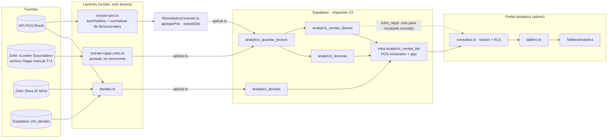

# 05 · Ruta de datos, persistencia, verificaciones y plan de aplicación

- **Fecha:** 2026-10-27.
- **Estado:** **migración 23 aplicada y carga inicial confirmada** en Supabase `jpqkmnfjwzniptszjuli` el 2026-10-27 (resultados en §9). Sin despliegue, commit ni push.
- **Decisiones vigentes:**
  - D1 aprobada (agregados tienda × día × canal).
  - D4 para la etapa 1: solo admin activo, toda la red.
  - D5 pendiente: Rappi separado y fuera de los KPI.
  - Etiquetas **propuestas** con definición visible: «Ventas con IVA» y «Unidades por ticket».
  - Metas y P.E.: «Sin datos».
- **Evidencia real:** extracciones, listas de tiendas e informes de ensayo con agregados por tienda viven **fuera del repo**, en `C:\Users\carlo\Respaldos\thecoffee-supabase\analytics-cargas\`.

## 1. Ruta de datos



- **Analytics:**
  - Lee únicamente `analytics_*` con la sesión del usuario; la RLS exige admin activo.
  - Nunca llama al POS ni a Zoho dentro de una petición.
  - Los KPI salen de `analytics_ventas_kpi`, que solo suma POS mostrador + app.
- **Sucursales:** sin cambios. Sigue leyendo el POS en vivo para sus sucursales asignadas y comparte código (`proveedor`, `normalizar`, `tiempo`) sin modificarlo.
- **CRM:** solo se lee al construir la lista de tiendas, para verificar identidad. Analytics no depende del CRM al consultar.
- **Preparado para después:**
  - **Metas y P.E. (D2):** fuente por decidir; el cliente de exportación de Zoho ya existe.
  - **Rappi:** fuente `zoho_rappi` separada; deduplicar exigirá cruzar pedido por pedido (`refundId` ↔ `Order ID`).
  - **Reportes por producto u hora:** requieren otra granularidad, fuera de D1.

## 2. Cobertura de la carga de ensayo (las 251 lecturas)

**Lectura completa ≠ día cerrado.**
- Una **lectura completa** de la API significa: todas las páginas, únicos = `totalItems` constante, sin registros inválidos ni fuera de ventana, en el instante `leido_en`.
- Un **día cerrado** es el que ya terminó en **todas** las zonas IANA de México contempladas (`ZONAS_MEXICO`, 12 zonas, incluidas las fronterizas con horario de verano de EE. UU.) **cuando se leyó**. El fin se calcula zona por zona (`ventanaDia`); no se supone cuál es la última.
- El martes 27 tiene **lecturas completas de un día abierto**: se guarda con `provisional = true`.

| Fuente · fecha | Esperadas | Leídas (completas) | Provisionales | Sin ventas | Faltantes | Composición |
|---|---|---|---|---|---|---|
| POS · lun 26 | 86 | 86 | 0 | 7 | 0 | Leído a las 19:13 UTC, con el día ya cerrado |
| POS · mar 27 | 86 | 86 | **86** | 7 | 0 | **Incluido como provisional**: lectura completa a las 19:13 UTC (13:13 CDMX) |
| POS · 28-oct a 1-nov | — | — | — | — | — | Futuras: no se leen ni se guardan |
| Zoho Rappi · lun 26 | 86 | 79 | 0 | 9 | 7 | Las 7 faltantes son las tiendas solo del CRM, sin filas en Zoho; quedan «sin lectura», no en cero |
| Zoho Rappi · mar 27 | 86 | 0 | — | — | 86 | Zoho aún no tiene el día (T+1) |
| **Total** | | **251** | 86 | | | 172 POS (86 × 2 días) + 79 Zoho Rappi |

- **«Sin ventas» en el POS:** las 7 tiendas que solo están en el CRM (companies 656, 681, 731, 732, 738, 739 y 742) se leyeron completas, con 0 pedidos ambos días.
- **«Sin ventas» en Zoho Rappi:** 9 tiendas con datos en Zoho ese día y 0 pedidos Rappi.

**Venta exacta por fuente, fecha y canal** (centavos a pesos, sin redondear):

| Fuente · fecha | Canal | Tickets | Unidades | Venta |
|---|---|---|---|---|
| POS · lun 26 | mostrador | 3,853 | 6,290 | $535,886.61 |
| | app | 214 | 334 | $26,270.60 |
| | **KPI (mostrador + app)** | **4,067** | **6,624** | **$562,157.21** |
| | rappi (excluido) | 24 | 46 | $5,163.00 |
| | desconocido | 0 | 0 | $0.00 |
| POS · mar 27 (provisional) | mostrador | 1,983 | 3,237 | $273,939.47 |
| | app | 144 | 199 | $17,562.45 |
| | **KPI** | **2,127** | **3,436** | **$291,501.92** |
| | rappi (excluido) | 14 | 24 | $2,872.00 |
| | desconocido | 0 | 0 | $0.00 |
| Zoho Rappi · lun 26 | rappi | 423 | 700 | $69,063.10 |
| | rappi_turbo | 215 | 370 | $39,951.20 |

**Conciliación contra extracciones exactas:**
- **POS de la auditoría (17:38 UTC):** 0 diferencias por tienda × canal.
- **Zoho, mostrador:** 79/79 tiendas con los mismos tickets y unidades; máximo 4 ¢ por tienda y +17 ¢ en total.
- **Zoho, app:** diferencia conocida por wallet, sin ajustar.
- **Zoho, Rappi:** exacto al centavo.
- **Ensayo transaccional:** 251 insertadas, segunda pasada con 251 ignoradas y conciliación por clave exacta sin diferencias (`aplicar-ensayo-2026-10-27T19-43-48-185Z.json`, fuera del repo).

## 3. Número de tienda 348 duplicado en el CRM

| Hecho | Evidencia |
|---|---|
| El CRM tiene dos tiendas con 348: «El Campanario - 348» (Operando) y «Hdz. Macías- 348» (Cerrada) | Lectura de `crm_tiendas` |
| **Ninguna company del POS tiene `lookerStoreId` 348** | `tiendas.ts`: `companies_con_numero_crm_repetido: []` |
| En Zoho, 348 = Hernández Macías (última venta 29-jun-2025) y **438 = Campanario** | Exportación de `Store ID` |
| El Campanario en el POS = company **547**, `lookerStoreId` **438**; se incluye **solo por Zoho**, porque el CRM no tiene el 438 | Lista de tiendas |
| Su lectura del 26 cuadra con Zoho en tickets y venta de mostrador | Conciliación por tienda (evidencia fuera del repo) |

**Conclusión:** el 348 duplicado **no afecta** la relación companyId ↔ lookerStoreId, que sale del catálogo del POS; no hay identidad ambigua ni exclusiones. Aun así, `tiendas.ts` ahora:
- **descuenta la relación del CRM** cuando su número está repetido;
- **excluye como «ambigua»** cualquier tienda que dependiera solo de ese número.

Al volver a ejecutarse, salen las **mismas 86 tiendas**. El CRM no se modificó.

## 4. Seguridad confirmada (pruebas en PGlite + migración real)

| Requisito | Resultado | Prueba |
|---|---|---|
| Vista con `security_invoker` | `reloptions` = `security_invoker=true`. Además, `anon` no tiene privilegios y `authenticated` solo `SELECT`, filtrado por la RLS de las tablas base | `tests/db/analytics.test.ts` y `revisarObjetos23` |
| La función de carga no se ejecuta con anon/authenticated | `has_function_privilege` = false para ambos; `anon` → «permission denied»; admin autenticado → «permission denied» | `tests/db/analytics.test.ts` |
| SECURITY DEFINER | **No se usa** (`prosecdef = false`): corre con los privilegios de quien carga (conexión de servicio). `search_path=""` y nombres calificados con `public.` | ídem |
| RLS | `lectura_admin` (SELECT, `tiene_rol('admin')`, que exige perfil activo) y `analytics_sin_oauth` restrictiva, ambas en forma initPlan | `tests/db/permisos.test.ts` |
| Rollback de la carga completa si falla la conciliación | `aplicarCarga` hace tiendas + lecturas + segunda pasada + conciliación en **una transacción**. Ante diferencia o error → ROLLBACK de todo, incluidas tiendas nuevas | `aplicarCarga (transacción completa)` en `tests/db/analytics.test.ts` |
| Migración transaccional y verificada | `migracion-23.ts`: parte de la versión 22 sin objetos; aplica, registra y exige que lo previo quede **idéntico** (políticas, funciones, tablas) y lo nuevo **exacto**. Si no, ROLLBACK | `tests/db/migracion-23.test.ts` |

## 5. Procedimiento de actualización (manual; sin sincronización recurrente)

1. **Refrescar el día provisional:** ejecutar `extraer-pos.ts` para la semana y después `aplicar.ts`.
   - Cada lectura nueva tiene `leido_en` mayor y reemplaza a la anterior, en sus 4 canales y de forma atómica.
   - Una lectura incompleta no se emite: la tienda queda en `fallidas` y conserva su lectura anterior.
   - Coste: ~87 GET al POS por corrida para 86 tiendas.
2. **Cerrar el día:** la fecha `F` cierra en el instante `ventanaDia(F).fin`, que es el máximo, entre las 12 zonas, del inicio local de `F + 1`. Ejemplos verificados en pruebas:
   - el 26-oct-2026 cierra a las **07:00 UTC** del 27 (Tijuana en horario de verano, UTC−7);
   - desde el 1-nov Tijuana usa UTC−8, así que el 2-nov cierra a las **08:00 UTC** del 3.
   - Solo una lectura hecha **después** de ese instante se guarda con `provisional = false`; antes, la base rechaza guardarla como cerrada.
   - No hay una hora fija («06:00 CDMX») que sirva para todo el año.
   - **Margen operativo recomendado:** releer a partir de `fin + 1 h`, por pedidos que sincronicen tarde. La API mostró segundos de retraso, pero no está garantizado.
3. **Qué ve el usuario:**
   - **Provisional:** el día abierto, con aviso de que cambiará.
   - **Pendiente de cierre:** el día terminó, pero su última lectura se hizo con el día abierto. Se lista en el aviso.
   - **Desactualizado:** la lectura del día en curso tiene más de **3 h**. Aviso en negritas.
   - **Lectura parcial / sin lectura:** tiendas faltantes por día, «no se cuentan como cero».
   - **Error de base:** tarjeta de error, nunca ceros.
   - Siempre visibles: «Última lectura» (hora CDMX) y cobertura «X de Y tienda-día».
4. **Sin _job_.** Programar estas corridas (p. ej. cada 30–60 min para el día abierto y a las 06:30 para el cierre) requiere aprobación aparte.

## 6. Plan de aplicación y reversión (pasos A, B, C–F ejecutados el 2026-10-27; ver §9)

Destino: Supabase `jpqkmnfjwzniptszjuli`. Precomprobación en solo lectura (2026-10-27 19:50 UTC):
- última versión registrada `20261024000022`;
- ningún objeto `analytics_*`;
- PostgreSQL **17.11**;
- `public.tiene_rol` presente.

### 6.1 Migración (requiere aprobación)

| Paso | Comando | Efecto |
|---|---|---|
| A. Ensayo remoto | `npx tsx scripts/analytics/migracion-23-aplicar.ts` | Aplica y verifica dentro de una transacción y termina en **ROLLBACK**. Requiere tu visto bueno porque ejecuta DDL en producción, aunque no deje nada |
| B. Aplicar | `npx tsx scripts/analytics/migracion-23-aplicar.ts --aplicar --confirmo jpqkmnfjwzniptszjuli` | Crea 3 tablas, 1 vista, 1 función y 6 políticas, y registra la versión 23. COMMIT solo si todo lo previo queda idéntico. Informe en `docs/analytics-zoho/informes/` (sin datos de ventas) |
| Reversión | `npx tsx scripts/analytics/migracion-23-aplicar.ts --revertir --confirmo jpqkmnfjwzniptszjuli` (o `docs/analytics-zoho/rollback-023.sql` en el SQL Editor) | Aborta si hay filas; borra los objetos y el registro; verifica que lo previo quede idéntico |

### 6.2 Carga (requiere aprobación; después de 6.1-B)

| Paso | Comando |
|---|---|
| C. Lista de tiendas (lectura) | `npx tsx --conditions=react-server scripts/analytics/tiendas.ts` |
| D. Lectura POS reciente (lectura) | `npx tsx --conditions=react-server scripts/analytics/extraer-pos.ts --tiendas <tiendas.json> --desde 2026-10-26 --hasta 2026-11-01` |
| E. Ensayo local | `npx tsx scripts/analytics/aplicar.ts --tiendas <tiendas.json> --lecturas <pos.json> --lecturas <zoho-rappi.json>` |
| F. Aplicar | `npx tsx scripts/analytics/aplicar.ts --tiendas <tiendas.json> --lecturas <pos.json> --lecturas <zoho-rappi.json> --destino supabase --confirmar jpqkmnfjwzniptszjuli` |

- **Contenido:** 86 tiendas y unas 251–258 lecturas (más si para entonces el 27 ya cerró y Zoho tiene el 27).
- **Transaccionalidad:** COMMIT solo si la segunda pasada lo ignora todo y la conciliación por clave da 0 diferencias.
- **Archivo de Rappi:** se reutiliza el ya extraído (26-oct). Volver a exportarlo (`extraer-rappi-zoho.ts`) es opcional y no recurrente.

### 6.3 Reversión de la carga (restaura, no solo borra)

- **Respaldo previo:** `aplicarCarga` toma, **dentro de la misma transacción y antes de escribir**, la foto exacta de las lecturas (con canales) y de las tiendas que la carga va a reemplazar. La guarda en el informe `aplicar-supabase-*.json`, fuera del repo.
- **Comando:** `npx tsx scripts/analytics/revertir-carga.ts --informe <aplicar-supabase-....json> --confirmar jpqkmnfjwzniptszjuli`.
- **Qué hace, en una transacción:**
  - borra las lecturas de sus `carga_id` (los canales caen en cascada);
  - **vuelve a guardar las versiones previas** del respaldo;
  - restaura las tiendas que ya existían;
  - quita las que la carga dio de alta y quedaron sin lecturas.
- **Si una clave ya pertenece a una carga posterior, aborta:** primero se revierte la posterior.
- **Prueba:** `revertirCarga restaura, no solo borra` en `tests/db/analytics.test.ts`.
- **En la carga inicial del 2026-10-27 el respaldo está vacío** (0 lecturas y 0 tiendas previas). Revertirla equivale a borrar sus dos `carga_id`.

SQL equivalente para el SQL Editor (solo válido cuando el respaldo está vacío, como en la carga inicial), en una transacción y con los `carga_id` del informe:

```sql
begin;
delete from public.analytics_lecturas where carga_id in ('<carga_pos>', '<carga_zoho_rappi>'); -- canales por cascada
delete from public.analytics_tiendas t
  where not exists (select 1 from public.analytics_lecturas l where l.company_id = t.company_id);
commit;
```

Después, si se quiere revertir el esquema: 6.1, «Reversión».

### 6.4 Despliegue

Es una aprobación separada. Antes de desplegar:
- confirmar en preview con un admin real;
- confirmar que un no admin es redirigido.

## 7. Pruebas ejecutadas

- **Typecheck:** `npx tsc --noEmit` ✅
- **Pruebas de Analytics:** `npx vitest run tests/db/analytics.test.ts tests/db/migracion-23.test.ts tests/portal/analytics.test.ts tests/portal/modulos.test.ts tests/db/permisos.test.ts` ✅
- **Suite completa:** ver la entrega. Solo falla `tests/migracion/paridad.test.ts`, por el Excel local ausente; es previo y ajeno.
- **Prueba visual con datos sintéticos** (`npm run prueba:visual`, `/?analytics`, `&desfase`, `&vacio`): escritorio y móvil a 375 px sin desborde; avisos de provisional, desactualizado y parcial; estado vacío sin ceros.

## 8. Pendientes de negocio

- **D2:** fuente de metas y P.E.
- **D3 y D6:** confirmar las etiquetas propuestas.
- **API de Brasil:** qué expondrá de Rappi y Rappi Turbo (número de Rappi, importe después de promociones, canal).
- **CRM:** número 348 duplicado (Campanario = 438 según POS y Zoho); no se tocó.
- **Programación de cargas:** frecuencia y responsable.

## 9. Resultado de la aplicación en producción (2026-10-27)

| Paso | Hora UTC | Resultado |
|---|---|---|
| Reconfirmación (solo lectura) | 19:56 | Proyecto `jpqkmnfjwzniptszjuli`; última versión `20261024000022`; 0 objetos `analytics_*`; PG 17.11; las 12 zonas existen en `pg_timezone_names` |
| A. Ensayo remoto de la migración | 19:56:55 | `previoIntacto: true`, objetos «exactamente los esperados», políticas 152 → 158, **ROLLBACK** |
| B. Migración 23 | 19:57:09 | **COMMIT**. Registro: `20261027000023 analytics_ventas_diarias` |
| C. Tiendas | 19:57:27 | 86 incluidas (69 Zoho + CRM, 10 solo Zoho, 7 solo CRM), 33 excluidas, 0 ambiguas |
| D. Extracción POS | 19:57:33–19:57:46 (`leido_en`) | 86/86 tiendas, 172 lecturas, 0 fallidas, 86 páginas; 21 tiendas con pedidos que no cuadran (sin ajustar) |
| E. Ensayo local | 19:58:01 | 251 insertadas, 251 ignoradas en la reejecución, 0 diferencias |
| F. Carga en Supabase | 19:58:56 | **COMMIT**: 251 insertadas, 251 ignoradas en la segunda pasada, 0 diferencias, 0 en KPI |

Cargas: POS `31619387-b5ef-4b6b-8e65-f499178d9621` (172 lecturas) y Zoho Rappi `267b6ad1-ee71-47b6-b31d-8ae49cd1f159` (79 lecturas, extraído a las 19:17:34 UTC). Informe con respaldo: `aplicar-supabase-2026-10-27T19-58-56-888Z.json`, fuera del repo.

**Comprobación posterior (solo lectura, en producción):**

| Fuente · fecha | Lecturas | Provisionales | Sin ventas | Mostrador | App | Rappi (excluido) |
|---|---|---|---|---|---|---|
| POS · lun 26 | 86 | 0 | 7 | 3,853 t · 6,290 u · $535,886.61 | 214 t · 334 u · $26,270.60 | 24 t · $5,163.00 |
| POS · mar 27 | 86 | 86 | 7 | 2,147 t · 3,513 u · $296,780.99 | 154 t · 220 u · $18,936.65 | 14 t · $2,872.00 |
| Zoho Rappi · lun 26 | 79 | 0 | 9 | — | — | Rappi 423 t · $69,063.10; Turbo 215 t · $39,951.20 |

- **KPI** (vista, mostrador + app):
  - lunes 26: **$562,157.21 · 4,067 tickets · 6,624 unidades**;
  - martes 27 (provisional, leído a las 13:57 CDMX): **$315,717.64 · 2,301 · 3,733**.
- **Contenido de la base contra los archivos:** 0 diferencias por fuente × fecha × canal.
- **Exclusión de Rappi:** 0 filas de la vista KPI que incluyan Rappi u otros canales.
- **Lunes 26 contra la lectura anterior de las 19:13:** idéntico.
- **Seguridad:**
  - la vista tiene `security_invoker=true`;
  - la función: `prosecdef=false`, `search_path=""`, sin EXECUTE para anon ni authenticated;
  - RLS activa en las 3 tablas, con 6 políticas;
  - `anon` sin privilegios; `authenticated` solo con SELECT.
- **RLS con roles simulados** (en una transacción de solo lectura descartada):
  - admin activo: 172 / 251 / 846 / 86 filas;
  - no admin: 0;
  - admin con token OAuth: 0;
  - anon: «permission denied».
  - No hay perfiles inactivos en producción; el caso inactivo está cubierto en PGlite.

**Siguiente refresco (manual):** el martes 27 cierra el 28-oct a las 07:00 UTC. Para fijarlo como cerrado, releer después de esa hora (recomendado desde las 08:00 UTC). No hay sincronización automática.
